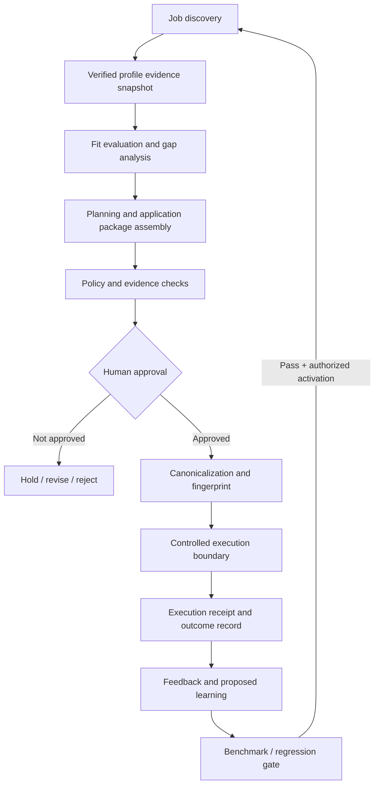
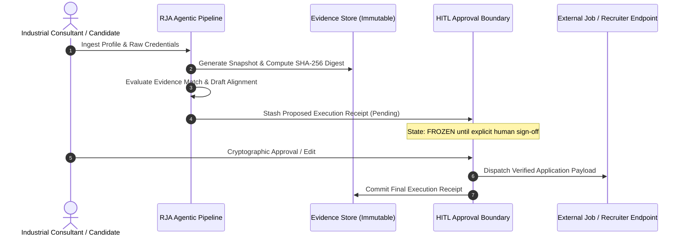

# Remote Job Accelerator (RJA) ⚡
> **Engineering-Grade Agentic System for Evidence-Grounded Career Orchestration**

[](https://codespaces.new/amareshdas3-eng/remote-job-accelerator?quickstart=1)
[](https://github.com/amareshdas3-eng/remote-job-accelerator/actions)
[](https://www.typescriptlang.org/)
[](#evidence-grounding--cryptographic-receipts)
[](LICENSE)

---

RJA is a TypeScript/Next.js software system exploring a core governance question for high-stakes AI workflows:

> **How can AI agents reason, evaluate, and prepare complex work without being permitted to invent evidence, approve their own output, or independently authorize consequential actions?**

Built by **Amaresh Das, PMP®** — an electrical engineering and project-delivery professional with 23+ years across heavy industrial infrastructure, power systems, commissioning, and operations. RJA applies systems-engineering rigor—formal interface boundaries, immutable evidence snapshots, risk controls, cryptographic fingerprints, and verification gates—to an agentic AI workflow.

**Repository baseline:** v5.2.0 architecture documentation  
**Stack:** Next.js 16 · React 19 · TypeScript 5.9 (Strict) · Supabase · Zod · SHA-256 artifact fingerprinting  
**Repository:** [amareshdas3-eng/remote-job-accelerator](https://github.com/amareshdas3-eng/remote-job-accelerator)

---

## ⚡ 60-Second Reviewer Guide

| If you are looking for... | Key Evidence & Implementation | Direct Source Reference |
| :--- | :--- | :--- |
| **System Architecture & Control Gates** | Human-in-the-loop (HITL) gate preventing execution without cryptographic sign-off. | [`lib/execution/`](lib/execution/) · [`docs/V5_AGENT_AUTHORITY_CONTRACT.md`](docs/V5_AGENT_AUTHORITY_CONTRACT.md) |
| **Evidence Grounding Engine** | Vector & rule retrieval coupled with immutable candidate snapshots; zero hallucination tolerance. | [`lib/matching/`](lib/matching/) · [`lib/evidence/`](lib/evidence/) |
| **Integrity & Receipts** | SHA-256 fingerprinting on match outputs and dispatch payloads for auditable traceability. | [`lib/execution/fingerprint.ts`](lib/execution/fingerprint.ts) · [`lib/execution/snapshot.ts`](lib/execution/snapshot.ts) |
| **Industrial Lineage** | Built by an industrial lead (23+ yrs heavy infrastructure & project controls) applying mission-critical rigor to agentic software. | [Engineering Lineage & Principles](#engineering-lineage--principles) |

---

## Start here — 30-second overview

| Engineering question | RJA approach |
|---|---|
| **What can agents do?** | Discover opportunities, evaluate fit, plan application steps, assemble draft packages, and propose controlled learning. |
| **What can agents not do?** | Approve applications, mutate verified evidence, or independently authorize execution. |
| **How is truth protected?** | Generated content is continuously validated against an immutable candidate evidence snapshot; unsupported claims are rejected. |
| **How is an approved artifact protected?** | Canonicalization and a SHA-256 fingerprint enforce tamper-proof integrity checks before execution dispatch. |
| **Who authorizes consequential action?** | The authenticated human remains the sole approval authority. |
| **How can behavior be checked?** | Strict TypeScript compilation, regression scripts, security-oriented tests, and documented resilience scenarios. |

---

## Why this project matters

Many AI demos focus on what a model can generate. RJA focuses on **what a governed system should permit**.

Its core invariant is:

$$\text{Agent Intelligence} \neq \text{Agent Authority}$$

The system cleanly separates the **AI proposal workflow** from the **deterministic execution boundary**. Agents operate as non-authoritative proposing components; policy guards, evidence integrity, and explicit human approvals constrain all consequential side effects.

This is a software portfolio project, not an electrical calculation tool. Its connection to industrial engineering is the discipline: define strict interfaces, identify failure modes, preserve evidence chains, enforce control boundaries, and independently verify outcomes.

---

## Architecture & Governance Lifecycle (Visual)

### High-Level Workflow


### Human-in-the-Loop Approval Sequence


---

<a id="evidence-grounding--cryptographic-receipts"></a>
## Evidence Grounding & Cryptographic Receipts

RJA treats generative AI tokens as **untrusted proposals** until mathematically verified against an evidence baseline:

1. **Immutable Evidence Snapshots:** Upon profile ingestion, credentials and claimed experiences are serialized, normalized, and hashed into a canonical SHA-256 snapshot (`lib/execution/snapshot.ts`).
2. **Hallucination Prevention:** The matching and tailoring engines (`lib/matching/engine.ts`) cross-reference every claim against the verified snapshot. Any skill or qualification not present in the evidence baseline triggers a policy violation.
3. **Canonical Fingerprints:** Approved application payloads undergo deterministic JSON key-sorting and whitespace normalization before computing the execution fingerprint (`lib/execution/fingerprint.ts`).
4. **Execution Receipts:** Dispatches generate an immutable audit receipt containing the timestamp, candidate fingerprint, payload hash, and dispatch response status.

---

## Engineering capabilities represented

- **Multi-agent orchestration:** Specialized discovery, evaluation, planning, orchestration, outcome, feedback, learning, and experimentation agents with bounded scopes.
- **Evidence-grounded generation:** AI output is treated as a proposal, not proof. Verified candidate information remains the source of truth.
- **Human approval boundary:** Agents have zero authority to approve or dispatch applications independently.
- **Artifact integrity:** Canonicalization and SHA-256 fingerprints detect post-approval drift or tampering.
- **Execution safeguards:** Idempotency, explicit policy checks, execution receipts, and outcome records are enforced at the runtime boundary.
- **Security-minded ingestion:** Hardened document-extraction (PDF / Word) and input-sanitization guards prevent prompt injection and unauthorized mutations.
- **Evaluation & controlled learning:** Workflow improvements are evaluated against benchmark fixtures before activation.

---

## Run it locally

### 1-Click Cloud Sandbox (No Local Setup Required)
Launch an instant, pre-configured development environment with Node.js and dependencies pre-installed:

[](https://codespaces.new/amareshdas3-eng/remote-job-accelerator?quickstart=1)

### Local Environment Setup
Requirements: Node.js 20+, npm, and basic environment configuration.

```bash
# Clone the repository
git clone https://github.com/amareshdas3-eng/remote-job-accelerator.git
cd remote-job-accelerator

# Install dependencies
npm install

# Run static typecheck (TypeScript strict mode)
npm run typecheck

# Run test suite
npm test
```

To run the Next.js development server:

```bash
npm run dev
```

**Verification note:** These commands are instructions. Review `package.json`, environment example files, and test output before deployment. Never commit secrets, personal candidate data, production credentials, or real application artifacts.

---

## Evidence and technical reading path

Start with the short executive overview, then inspect the code and test suites:

1. [Executive Architecture Certificate](docs/RJA_ARCHITECTURE_CERTIFICATE.md) — Core design and documented validation summary.
2. [Architecture Freeze Certificate](docs/ARCHITECTURE_FREEZE_CERTIFICATE.md) — Documented baseline and change-control principles.
3. [Evidence-Bounded Agentic Architecture Case Study](docs/CASE_STUDY_EVIDENCE_BOUNDED_AGENTIC_ARCHITECTURE.md) — Design rationale and governance model.
4. [Gate 5 Unified Audit](docs/GATE_5_UNIFIED_RJA_AUDIT.md) — Documented audit dimensions.
5. [Resilience Matrix](docs/V5_BETA2_RESILIENCE_MATRIX.md) — Hostile and failure-case test coverage.
6. [Leadership Portfolio Dossier](docs/LEADERSHIP_PORTFOLIO_DOSSIER.md) — Project-management and systems-engineering narrative.

For implementation-level review, inspect `lib/execution/`, the agent authority contracts in `docs/V5_AGENT_AUTHORITY_CONTRACT.md`, the policy checks, and the tests referenced by `package.json`.

---

<a id="engineering-lineage--principles"></a>
## Engineering Lineage & Principles

RJA translates 23+ years of industrial power systems, commissioning, and project leadership into the design of mission-critical AI software:

- **Generation is never evidence.**
- **Agents propose; authorized humans approve.**
- **Fail closed when authority, evidence, or integrity checks fail.**
- **Keep approval and execution responsibilities separate.**
- **Make claims auditable, deterministic, and testable.**
- **Measure outcomes; distinguish documented results from independently reproduced results.**

### Project and professional context

RJA demonstrates how an engineering-led delivery approach applies to AI systems: rigorous requirements, architecture boundaries, risk controls, test gates, release discipline, and operational feedback.

For collaboration, technical review, or project-management / AI workflow opportunities, connect through [Amaresh Das on LinkedIn](https://www.linkedin.com/in/amaresh-das/).

---

*Portfolio project and engineering reference. Review the code, configuration, license, and security posture before reuse or deployment. No repository documentation substitutes for an independent security review or environment-specific validation.*
