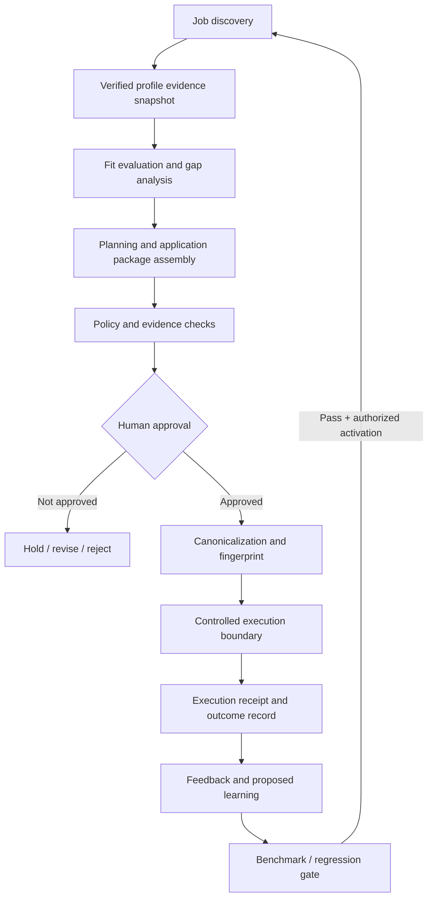

# Remote Job Accelerator (RJA)
### Evidence-bounded agentic AI • Technical project delivery • Human-controlled execution

RJA is a TypeScript/Next.js project exploring a practical question for high-stakes AI workflows:

> **How can AI agents reason and prepare useful work without being allowed to invent evidence, approve their own output, or independently authorize consequential actions?**

Built by **Amaresh Das, PMP®** — an electrical engineering and project-delivery professional with 23+ years across industrial infrastructure, power systems, erection and commissioning, operations, and maintenance. RJA applies a systems-engineering mindset—defined boundaries, evidence, risk controls, traceability, and verification—to an agentic AI workflow.

**Repository baseline:** v5.2.0 architecture documentation  
**Stack:** Next.js 16 · React 19 · TypeScript · Supabase · Zod · SHA-256 artifact fingerprinting  
**Repository:** [amareshdas3-eng/remote-job-accelerator](https://github.com/amareshdas3-eng/remote-job-accelerator)

---

## Start here — 30-second overview

| Engineering question | RJA approach |
|---|---|
| What can agents do? | Discover, evaluate, plan, assemble drafts, and propose controlled learning. |
| What can agents not do? | Approve applications, mutate verified evidence, or independently authorize execution. |
| How is truth protected? | Generated content is checked against a candidate evidence snapshot; unsupported claims must not be treated as facts. |
| How is an approved artifact protected? | Canonicalization and a SHA-256 fingerprint support integrity checks before execution. |
| Who authorizes consequential action? | The authenticated human remains the approval authority. |
| How can behavior be checked? | Type checks, regression scripts, security-oriented tests, and documented resilience scenarios. |

## Why this project matters

Many AI demos focus on what a model can generate. RJA focuses on **what a governed system should permit**.

Its core invariant is:

**Agent intelligence ≠ agent authority.**

The system separates an AI proposal workflow from the deterministic execution boundary. Agents are designed as non-authoritative components; policy checks, evidence integrity, and explicit human approval constrain consequential actions.

This is a software portfolio project, not an electrical design or power-system calculation tool. Its connection to industrial engineering is the method: define interfaces, identify failure modes, preserve evidence, enforce boundaries, and verify outcomes.

## Architecture at a glance



The diagram describes the intended governed lifecycle; consult the implementation and test results to verify the behavior of a specific checkout.

## Engineering capabilities represented

- **Multi-agent orchestration:** specialized discovery, evaluation, planning, orchestration, outcome, feedback, learning, and experimentation responsibilities.
- **Evidence-grounded generation:** AI output is a proposal, not proof. Verified candidate information remains the source of truth.
- **Human approval boundary:** agents do not grant themselves permission to approve or dispatch.
- **Artifact integrity:** canonicalization and SHA-256 fingerprints help detect post-approval changes.
- **Execution safeguards:** idempotency, explicit policy checks, execution receipts, and outcome records are part of the documented design.
- **Security-minded ingestion:** the project includes document-extraction and input-handling tests; deployment security still depends on configuration and environment.
- **Evaluation and controlled learning:** changes are intended to be evaluated against benchmark fixtures before activation.

## Run it locally

Requirements: a compatible Node.js runtime, npm, and the repository's required environment configuration.

```bash
git clone https://github.com/amareshdas3-eng/remote-job-accelerator.git
cd remote-job-accelerator
npm install
npm run typecheck
npm test
```

To run the Next.js development server after configuring the environment required by the application:

```bash
npm run dev
```

**Verification note:** these commands are instructions, not a claim that they have been executed in your environment. Review the current `package.json`, environment example files, test output, and relevant implementation before deploying. Never commit secrets, personal candidate data, production credentials, or real application artifacts.

## Evidence and technical reading path

Start with the short executive overview, then inspect the code and test files. Validation figures in project reports should be read with their stated scope, dataset, and method; do not treat a badge or report alone as independent certification.

1. [Executive Architecture Certificate](docs/RJA_ARCHITECTURE_CERTIFICATE.md) — core design and documented validation summary.
2. [Architecture Freeze Certificate](docs/ARCHITECTURE_FREEZE_CERTIFICATE.md) — documented baseline and change-control principles.
3. [Evidence-Bounded Agentic Architecture Case Study](docs/CASE_STUDY_EVIDENCE_BOUNDED_AGENTIC_ARCHITECTURE.md) — design rationale and governance model.
4. [Gate 5 Unified Audit](docs/GATE_5_UNIFIED_RJA_AUDIT.md) — documented audit dimensions.
5. [Resilience Matrix](docs/V5_BETA2_RESILIENCE_MATRIX.md) — hostile and failure-case test coverage.
6. [Leadership Portfolio Dossier](docs/LEADERSHIP_PORTFOLIO_DOSSIER.md) — project-management and systems-engineering narrative.

For implementation-level review, inspect `lib/execution/`, the agent authority contracts, the policy checks, and the tests referenced by `package.json`.

## Engineering principles

- **Generation is never evidence.**
- **Agents propose; authorized humans approve.**
- **Fail closed when authority, evidence, or integrity checks fail.**
- **Keep approval and execution responsibilities separate.**
- **Make claims auditable and testable.**
- **Measure outcomes; distinguish documented results from independently reproduced results.**

## Project and professional context

RJA demonstrates how an engineering-led delivery approach can be applied to AI systems: requirements, architecture boundaries, risk controls, test gates, release discipline, and operational feedback.

For collaboration, technical review, or project-management / AI workflow opportunities, connect through [Amaresh Das on LinkedIn](https://www.linkedin.com/in/amaresh-das/).

---

*Portfolio project and engineering reference. Review the code, configuration, license, and security posture before reuse or deployment. No repository documentation substitutes for an independent security review or environment-specific validation.*
